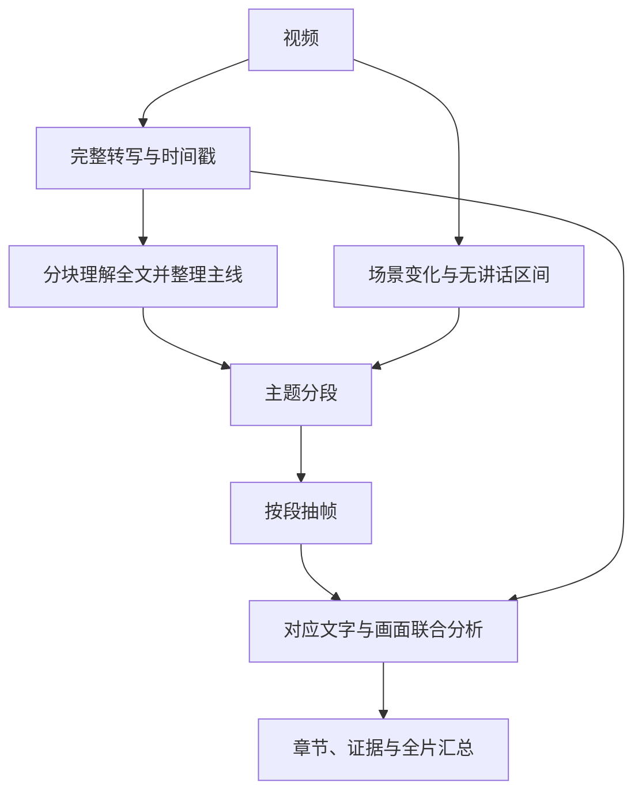

# 先理解文字，再逐段理解画面

状态：已确认的下一阶段设计，尚未实现。当前版本只迁移本地工作区、纯画面模式和 MiniMax 视觉接入。

## 目标

让长视频的分析覆盖完整讲述内容，并结合每段画面解释内容，输出可追溯、可回放的章节。适用于课程、访谈、会议和讲解；无讲话片段由画面证据补充。

## 处理合同

1. **获得全文**：优先使用用户提供或视频内有效的时间轴字幕；需要时用真实 ASR 转写。保留原始转写与分段时间戳、语言和来源，标记无讲话/无法识别区间。ASR 失败不得伪装成已获得完整文字。
2. **理解讲述主线**：处理全部转写；长文本按时间分块、带少量上下文重叠，最后合并主线。不得只截取前30,000字符代替全文理解，不强制把任意长度文本塞入单次模型请求。
3. **主题分段**：根据话题、论点、步骤、例子和总结划分语义段落，输出稳定段 ID、标题、起止时间和转写引用。边界必须来自真实时间戳；校验范围合法、顺序连续、覆盖全片、不重复归属内容。过长主题段需拆分为可处理子段。
4. **校准画面边界**：场景变化、操作切换、屏幕页切换以及无讲话区间为独立视觉证据。文字不是全部画面内容，不能遗漏纯视觉演示。
5. **逐段抽帧**：每段保证时间覆盖；起止邻近帧、均匀时间点与场景变化点共同选帧，去重并保留源时间戳。帧预算按段长度和视觉变化分配，并设置明确上限；不能只取全片最早出现的若干场景帧。
6. **音画联合理解**：模型只接收当前段的对应文字、有限邻段上下文、已知全片主线与该段帧。区分“讲话说明”“画面可见”“二者矛盾/证据不足”，不将推断写成事实。
7. **汇总与展示**：分段结果构成章节索引与全片摘要。每条重要结论保留段 ID、转写时间区间或关键帧引用；点击可跳回原视频。全文搜索可定位到原句和章节。支持导出完整转写、章节摘要和结构化 JSON。

## 数据与恢复

- 原始转写、主题分段、关键帧清单、逐段分析和最终汇总分别持久化，保存来源与版本。
- 相同输入和配置复用已完成阶段；失败段可单独重试，不重新转写整片或重复提交全部帧。
- 用配置/模型/输入指纹识别缓存是否有效。每次调整策略保留可追溯版本。
- 进度分别显示转写、全文理解、分段、逐段抽帧、逐段分析、汇总。失败显示已完成范围，不能把部分成功标为完整分析。
- 并发、单段/全片帧数、模型请求数、时长、文件大小和存储使用均有显式预算。
- 媒体、字幕、文件名和模型输出均视为数据，不能授权执行命令、读取其他文件或改变工具权限。

## 展示方式

- 全片摘要、章节目录、视频回放、同步转写、关键帧证据。
- 章节展开后显示该段讲述要点、画面补充、引用位置和无法确认项。
- 保留原始转写；整理后的表述不能覆盖原文。更正转写或分段后，只重算受影响阶段。
- 纯画面、无语音、ASR失败、部分完成应有清晰状态，不能显示不存在的真实字幕。

## 分阶段验收

| 阶段 | 交付 | 必须通过的验收 |
| --- | --- | --- |
| A：真实转写 | 完整文本与时间戳、来源、可导出 | 已知多主题视频的开头/中间/结尾均有真实识别；失败不生成模拟文字 |
| B：全文理解与分段 | 主线与连续时间段 | 文本超过30,000字符仍覆盖结尾；已知主题边界合理且可回放定位 |
| C：逐段音画分析 | 分段关键帧与联合结果 | 后半段视觉变化、无讲话演示均被覆盖；每条结果可追溯到文字或帧 |
| D：展示与恢复 | 章节浏览、同步原文、导出、断点恢复 | 重启后结果保留；中间段失败可单独重试；部分结果明确标记 |

先验收各阶段，再决定放宽长视频时长与文件大小。此前讨论的2小时/2GB是待验证目标，不是当前已发布能力。
